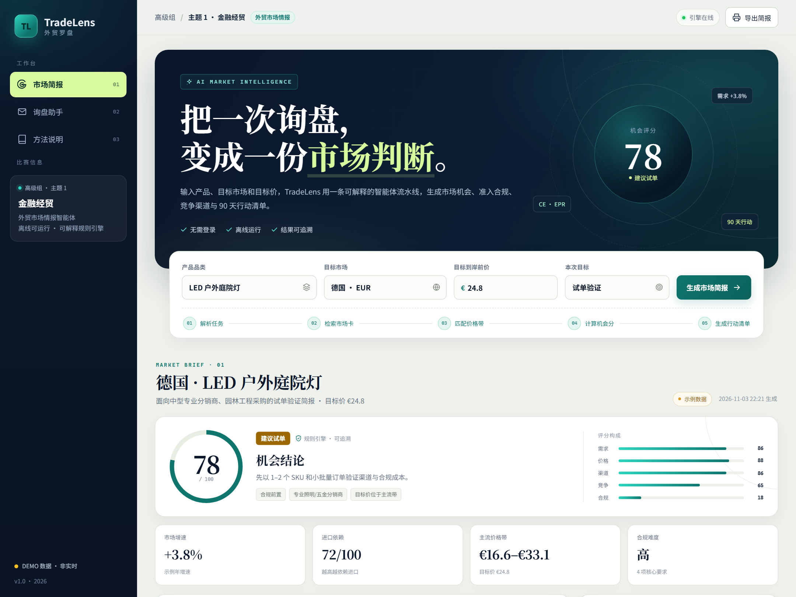

# TradeLens 外贸罗盘

> **高级组 · 主题 1：金融经贸**  
> 参赛方向：外贸市场情报智能体  
> 一句话：把一次询盘，变成一份可执行的市场判断。

TradeLens 是一个面向中小外贸团队的市场情报工作台。输入产品品类、目标市场、目标价和本次目标，它会生成一份包含**机会评分、需求信号、准入合规、竞争渠道、风险与 90 天行动清单**的市场简报；同时可以把一封客户询盘拆成可跟进字段，识别低价、急单和信息缺口，并生成一版英文回复草稿。



## 项目介绍

- [项目介绍 PDF](docs/TradeLens_项目介绍.pdf)（6 页，含封面、产品方案、演示案例、技术架构与评分维度）
- [项目介绍 DOCX](docs/TradeLens_项目介绍.docx)（可编辑版）
- [作品海报](poster/TradeLens_poster_official.png)（1080 × 1525，官方模板版式）

## 比赛信息

| 项目 | 内容 |
| --- | --- |
| 组别 | 高级组（大二、大三） |
| 主题 | 主题 1 · 金融经贸 |
| 作品形态 | Web 应用 / 单页工作台 |
| 技术栈 | Python 3 标准库 + 原生 HTML / CSS / JavaScript |
| 外部依赖 | 0（不需要数据库、API Key、npm 或 pip 安装） |
| 演示数据 | 5 个目标市场 × 5 个外贸品类，共 25 组结构化市场卡 |

## 解决的问题

外贸业务员做一个新市场判断，通常要在海关网站、认证机构、电商平台、竞品页面和聊天记录之间来回切换：

- 市场机会靠经验，缺少可复用的判断框架；
- 关税、认证、标签和回收责任散落，报价前容易漏项；
- 询盘回复靠手工，低价、急单和信息缺口没有统一检查；
- 大模型能写得很像，但现场演示时可能断网、超时或产生不可核验的数字。

TradeLens 把这件事拆成一条**可解释的智能体式流水线**：先结构化事实，再评分，最后生成动作。比赛版优先保证稳定、可演示、可追溯。

## 核心功能

### 1. 市场简报生成

选择产品和市场后，点击「生成市场简报」，输出：

- **机会评分**：需求 35% · 价格 25% · 渠道 15% · 竞争 15% · 合规 10%；
- **四张核心指标卡**：市场增速、进口依赖、主流价格带、合规难度；
- **需求信号**：4 个观察点，而不是泛泛的“市场很大”；
- **准入与合规**：关税、增值税、认证、标签、原产地单证；
- **竞争与渠道**：竞争分层、参考价格带、渠道适配度；
- **风险与行动**：4 项风险 + 0–30 / 30–60 / 60–90 / 90 天+ 的行动路径；
- **执行轨迹**：每一步检索和计算都能展开查看。

### 2. 询盘解析台

粘贴一封英文或中文询盘，规则引擎会抽取：

- 产品、数量、目标价、目的地、期望交付、贸易条款、认证要求；
- 计算询盘质量分（A/B/C）和跟进建议；
- 标出「目标价低于主流带」「交期偏紧」「认证待补」「贸易条款未明确」等风险；
- 生成一版英文回复草稿，可一键复制后人工修改。

### 3. 导出与响应式

- 「导出简报」调用浏览器打印，可另存为 PDF；
- 桌面、平板和手机均有响应式布局；
- 移动端提供侧边栏抽屉与遮罩层。

## 快速开始

要求：Python 3.9+。项目没有第三方依赖。

```bash
cd tradelens
python app.py
```

Windows 如果没有 `python` 命令，可以使用：

```powershell
py -3 app.py
```

打开 <http://127.0.0.1:8000>。

指定端口或让局域网访问：

```powershell
$env:PORT = "8080"
$env:HOST = "0.0.0.0"
python app.py
```

> 默认只监听 `127.0.0.1`。公网部署前请增加反向代理、访问控制和速率限制。

## 使用路径（现场演示建议）

1. 打开首页，默认展示「德国 × LED 户外庭院灯 × €24.8」的简报；
2. 把目标市场切到「越南」，观察价格带、认证和渠道随之变化；
3. 修改目标价到明显低于主流带，重新生成，观察评分和行动建议变化；
4. 滚动到「询盘解析台」，点击「填入示例」；
5. 指出 65 分 B 级询盘、€14.5 目标价低于 €16.6–€33.1 参考带、21 天交期偏紧；
6. 复制英文回复草稿，说明人工复核后才可发送；
7. 点击「查看智能体执行过程」，解释评分不是黑盒。

## 架构

```text
浏览器（原生 HTML / CSS / JS）
        │
        ├── POST /api/analyze  ──► engine.analyze_market()
        │                              │
        │                              ├─ 市场卡（关税 / 认证 / 渠道 / 买家）
        │                              ├─ 品类卡（价格带 / 需求驱动 / 竞争分层）
        │                              └─ 五维加权评分 + 行动生成
        │
        └── POST /api/inquiry  ──► engine.parse_inquiry()
                                       ├─ 实体抽取（数量 / 价格 / 交期 / 条款）
                                       ├─ 价格带对比与风险标记
                                       └─ 英文回复模板
```

服务端只依赖 Python 标准库：

- `http.server.ThreadingHTTPServer` 提供静态文件和 JSON API；
- `engine.py` 保存全部市场/品类数据、评分逻辑、询盘解析和回复模板；
- 前端不依赖框架或构建工具，减少现场环境风险。

### API

| 方法 | 路径 | 说明 |
| --- | --- | --- |
| GET | `/api/health` | 健康检查 |
| GET | `/api/options` | 返回品类、市场、目标选项 |
| POST | `/api/analyze` | 生成市场简报 |
| POST | `/api/inquiry` | 解析询盘 |

请求示例：

```json
{
  "category": "led_outdoor",
  "market": "DE",
  "target_price": 22,
  "goal": "trial"
}
```

## 测试

```bash
python -m unittest discover -s tests -v
```

共 13 个测试，覆盖：

- 默认简报稳定性与 25 组品类 × 市场组合；
- 价格带定位与评分变化；
- 多币种格式化；
- 询盘字段抽取、低价/急单风险、英文回复；
- HTTP API 健康检查、分析接口、错误请求和静态页面。

## 设计取舍

| 选择 | 原因 |
| --- | --- |
| 结构化市场卡 | 先约束事实，再生成文本，减少“看起来很像”的幻觉 |
| 可解释评分 | 评委和业务员都能追问“为什么是这个分” |
| 规则解析询盘 | 数量、目标价、交期是强字段，规则比自由生成更稳定 |
| 零外部依赖 | 现场断网、没有 API Key 也能完成演示 |
| 模板化英文回复 | 输出可编辑、可审计，不让 AI 直接替用户发邮件 |

这套结构也为后续接入实时数据和大模型留了位置：市场卡可以替换为海关/关税 API，回复模板可以交给 LLM 做多语言润色，但评分和合规校验仍应保留可核验的中间层。

## 数据说明

**重要：本项目是比赛 Demo，不是实时贸易数据库。**

- 市场增速、进口依赖、电商渗透率、价格带均为基于公开行业经验整理的**示例值**；
- 关税、认证、标签和原产地规则会随 HS 编码、产品功能和目的国法规变化；
- 页面中的「示例数据」标识和免责声明不是装饰，正式报价前必须复核；
- 项目不包含任何真实客户询盘、个人信息或企业内部数据。

## 目录

```text
tradelens/
├── app.py                       # 标准库 HTTP 服务与 API
├── engine.py                    # 市场卡、评分、询盘解析、回复模板
├── web/                         # 单页工作台
├── tests/                       # 13 个引擎/API 测试
├── docs/
│   ├── TradeLens_项目介绍.pdf    # 6 页项目介绍
│   ├── TradeLens_项目介绍.docx   # 可编辑版
│   └── assets/                  # 文档配图
├── poster/
│   ├── TradeLens_poster_official.png
│   ├── poster_official.html
│   └── official_template*.png
├── screenshots/                 # 产品截图
├── scripts/                     # 文档、海报、截图脚本（非运行必需）
├── README.md
├── SUBMISSION.md                # 提报系统可直接使用的文案与检查清单
└── LICENSE
```

## 已知限制

- 目前是单用户、无登录的本地 Demo，没有项目持久化；
- 仅内置 5 个市场 × 5 个品类，新增市场需要补充市场卡；
- 市场数据不是实时数据，不能替代海关、认证机构或目的国官方咨询；
- 英文回复是模板草稿，发送前必须人工核对价格、交期和认证范围。

## 后续路线

1. 接入海关编码/关税 API、Google Trends、展会采购商数据；
2. 增加汇率、运价、认证周期和到岸成本测算；
3. 用 LLM 做多语言润色、买家画像总结和邮件个性化，但保留事实校验层；
4. 增加多用户、项目空间、历史版本和团队协作；
5. 部署到国内云服务，提供公开体验链接。

## 提交材料

- 作品基本信息：见 [SUBMISSION.md](SUBMISSION.md)
- 作品海报：[poster/TradeLens_poster_official.png](poster/TradeLens_poster_official.png)（1080 × 1525）
- 项目介绍：[docs/TradeLens_项目介绍.pdf](docs/TradeLens_项目介绍.pdf)
- 项目源码：当前仓库
- 本地运行地址：<http://127.0.0.1:8000>

## License

MIT License，见 [LICENSE](LICENSE)。
